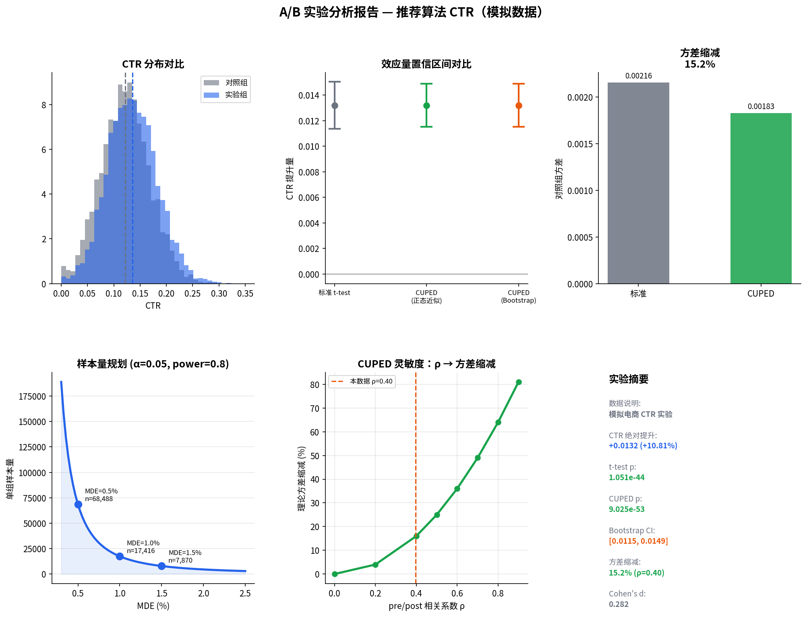

# A/B 实验分析 + CUPED 方差缩减

用**模拟电商 CTR 数据**演示完整 A/B 分析流程：SRM 检查、AA 验证、Welch t-test、CUPED（含 Bootstrap CI）、功效/MDE 样本量规划，以及协变量相关性灵敏度表。

> **数据说明**：本仓库数据由 `generate_data.py` 合成，真实处理效应已知（默认 +0.012 CTR）。不是真实公司日志，仅用于方法演示与面试作品展示。

## 要解决什么问题

线上做推荐算法实验时，常见痛点是：

1. **分流是否可信**：样本量是否按 1:1、实验前指标是否已有差异（SRM / AA）。
2. **结论是否稳健**：普通 t-test 在噪声大时置信区间宽、功效不足。
3. **如何用更少样本做灵敏实验**：用实验前指标做协变量（CUPED）降低方差。
4. **开跑前如何定规模**：给定 MDE / α / power，需要多少人、跑几天。

本项目把上述步骤串成可复现的 CLI 脚本，并输出图表。

## 方法概览

| 步骤 | 方法 | 作用 |
|------|------|------|
| SRM | χ² goodness-of-fit | 检查 control/treatment 人数是否偏离预期比例 |
| AA | Welch t-test on `pre_ctr` | 实验前两组应无显著差异 |
| AB | Welch t-test on `post_ctr` | 估计 uplift、CI、Cohen's d |
| CUPED | `Y_cuped = Y - θ(X - μ_X)`，θ = Cov(X,Y)/Var(X) | 用 pre 指标缩减方差；另给 **Bootstrap 百分位 CI** |
| Power | 两比例样本量公式 | 给定 MDE 反推单组 n |
| Sensitivity | 理论缩减 ≈ ρ² | 不同 pre/post 相关下 CUPED 收益多大 |

## 项目结构

```
ab-test-cuped/
├── generate_data.py   # 合成实验 CSV（可调 n / effect / seed）
├── analysis.py        # CLI 入口：跑完整分析并出图
├── ab_stats.py        # 统计函数（SRM / AA / t-test / CUPED / power / sensitivity）
├── ab_viz.py          # 报告图
├── requirements.txt   # 锁定依赖版本
├── data/
│   └── ab_experiment.csv
└── output/
    └── ab_test_report.png
```

## 环境与运行

需要 Python 3.10+（在 3.13 上验证过）。

```bash
python -m venv .venv
source .venv/bin/activate   # Windows: .venv\Scripts\activate
pip install -r requirements.txt

python generate_data.py     # 可选：重新生成模拟数据
python analysis.py          # 默认读 data/ab_experiment.csv，写出 output/ab_test_report.png
```

常用参数：

```bash
python generate_data.py --n 5000 --effect 0.012 --seed 42
python analysis.py --data data/ab_experiment.csv --bootstrap 5000 --alpha 0.05 --power 0.80
```

## 样例输出（默认 seed=42，n=5000/臂）

重新跑脚本后数字会以终端为准；以下为一次典型结果的数量级：

| 检查项 | 结果（示例） |
|--------|----------------|
| SRM | 5000 : 5000，p ≈ 1.0，通过 |
| AA (`pre_ctr`) | p > 0.05，通过 |
| 绝对 uplift | 约 +0.01 量级 |
| t-test / CUPED | 均显著；CUPED 方差更低、CI 更窄 |
| Bootstrap CUPED CI | 与正态近似 CI 接近（大样本下） |
| 方差缩减 | 取决于观测 ρ；理论期望约 ρ² |

报告图：



## 相对模板多做了什么

1. **SRM 检查**：分流比例异常时先亮红灯，避免盲目解读 uplift。
2. **CUPED Bootstrap CI**：每次重采样内重估 θ 与全局 pre 均值，反映估计不确定性，而不只信正态近似。
3. **ρ 灵敏度表 + 图**：说明「协变量相关多高才值得接 CUPED」——ρ=0.5 约减方差 25%，ρ=0.7 约 49%。

## 面试可讲的点

- **统计显著 ≠ 业务显著**：结合 CI、相对提升、Cohen's d 和 MDE 一起决策。
- **CUPED 不是换指标**：调整后均值差仍估计同一 uplift，方差按 ρ² 缩减（理想情况）。
- **开跑前定 MDE**：避免 peeking / p-hacking；样本量公式假设与指标分布要匹配业务。
- **先做 SRM + AA**：工程分流 bug 比「算法没效果」更常见。

## 技术栈

Python · NumPy · Pandas · SciPy · Matplotlib

## License

MIT（演示代码；数据为合成，可自由修改参数重跑）。
